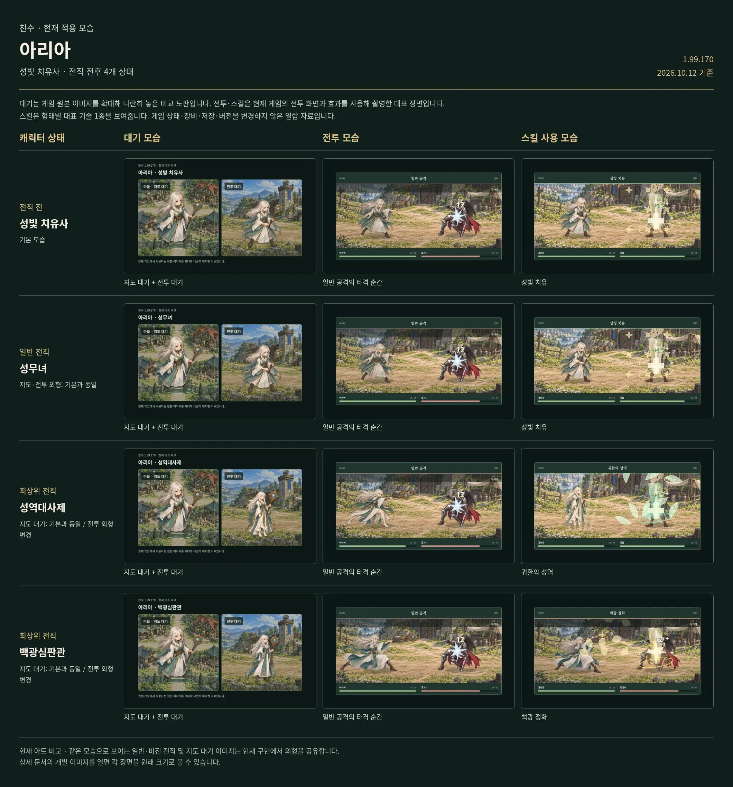

# 아리아 · 기본 모습과 전직 모습

[← 전체 캐릭터 목록](../README.md)

**기본 역할:** 성빛 치유사 · **비교 상태:** 4종

**각 행은 왼쪽부터 대기 / 전투 / 대표 스킬 순서입니다.** 이미지를 누른 뒤 확대하면 자세히 볼 수 있습니다.

[비교표 크게 열기](../sheets/aria.webp)

## 비교표의 행별 안내

| 위에서 | 상태 | 직업·형태 | 대표 스킬 | 현재 외형 |
|---|---|---|---|---|
| 1번째 행 | 전직 전 · 기본 | 성빛 치유사 | 성빛 치유 | 전직 전의 현재 기본 외형입니다. |
| 2번째 행 | 일반 전직 후 | 성무녀 | 성빛 치유 | 기본과 같은 외형입니다. 전직에 따른 능력치·기술 변화는 적용됩니다. |
| 3번째 행 | 최상위 전직 후 | 성역대사제 | 귀환의 성역 | 전투·스킬 외형이 달라집니다. 지도·마을 대기 외형은 기본과 같습니다. |
| 4번째 행 | 최상위 전직 후 | 백광심판관 | 백광 정화 | 전투·스킬 외형이 달라집니다. 지도·마을 대기 외형은 기본과 같습니다. |

**일반 전직·비전 전직의 외형은 기본과 같습니다. 최상위 전직의 전투 외형은 변경되며 지도·마을 대기 외형은 기본을 유지합니다.**

## 1번째 행 · 전직 전 · 기본 — 성빛 치유사

전직 전의 현재 기본 외형입니다.

대표 스킬: **성빛 치유**

## 2번째 행 · 일반 전직 후 — 성무녀

기본과 같은 외형입니다. 전직에 따른 능력치·기술 변화는 적용됩니다.

대표 스킬: **성빛 치유**

## 3번째 행 · 최상위 전직 후 — 성역대사제

전투·스킬 외형이 달라집니다. 지도·마을 대기 외형은 기본과 같습니다.

대표 스킬: **귀환의 성역**

## 4번째 행 · 최상위 전직 후 — 백광심판관

전투·스킬 외형이 달라집니다. 지도·마을 대기 외형은 기본과 같습니다.

대표 스킬: **백광 정화**

대기 이미지는 현재 지도·마을 및 전투 대기 아트를 함께 보여주는 비교 도판입니다. 전투·스킬 이미지는 현재 게임 전투 컴포넌트의 대표 장면입니다. 스킬 한 장은 전체 애니메이션 중 한 순간입니다.
