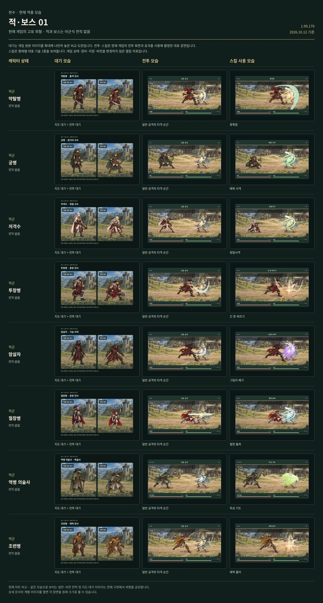

# 암살자

[← 적·보스 목록](README.md) · [전체 캐릭터 목록](../README.md)

**구분:** 일반 적 · **역할:** 기습 자객

**아래 비교표의 위에서 5번째 행이 암살자입니다.** 왼쪽부터 대기 / 전투 / 대표 스킬 순서입니다.

대표 스킬: **그림자 베기**

게임 데이터의 대표 기술명

[모음 01 비교표 크게 열기](../sheets/enemies-01.webp)

## 같은 비교표에 있는 외형

1. 약탈병
2. 궁병
3. 저격수
4. 투창병
5. **암살자**
6. 철창병
7. 역병 의술사
8. 조련병

적·보스에는 아군식 전직이 없습니다. 대기는 전술지도·전투 대기 아트 비교이며 전투·스킬은 현재 게임의 대표 장면입니다.
