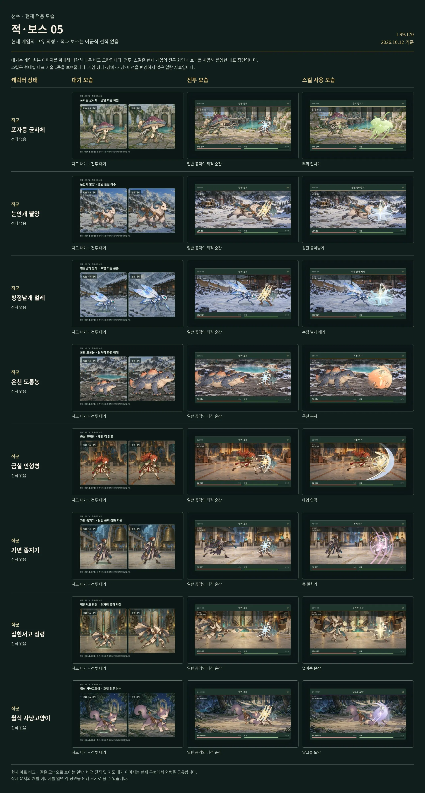

# 금실 인형병

[← 적·보스 목록](README.md) · [전체 캐릭터 목록](../README.md)

**구분:** 일반 적 · **역할:** 태엽 검 전열

**아래 비교표의 위에서 5번째 행이 금실 인형병입니다.** 왼쪽부터 대기 / 전투 / 대표 스킬 순서입니다.

대표 스킬: **태엽 연격**

게임 데이터의 대표 기술명

[모음 05 비교표 크게 열기](../sheets/enemies-05.webp)

## 같은 비교표에 있는 외형

1. 포자등 균사체
2. 눈안개 뿔양
3. 빙정날개 벌레
4. 온천 도롱뇽
5. **금실 인형병**
6. 가면 종지기
7. 접힌서고 정령
8. 월식 사냥고양이

적·보스에는 아군식 전직이 없습니다. 대기는 전술지도·전투 대기 아트 비교이며 전투·스킬은 현재 게임의 대표 장면입니다.

## 이 외형을 사용하는 스테이지 대장

| 스테이지 | 대장 이름 |
|---|---|
| 41장 · 멎지 않는 망치 | 금실 인형장 |
| 44장 · 이름 없는 작업대 | 공방 공정장 |

보스의 2페이즈는 동일한 몸체 아트에 효과·표시·공격 패턴이 달라집니다.
