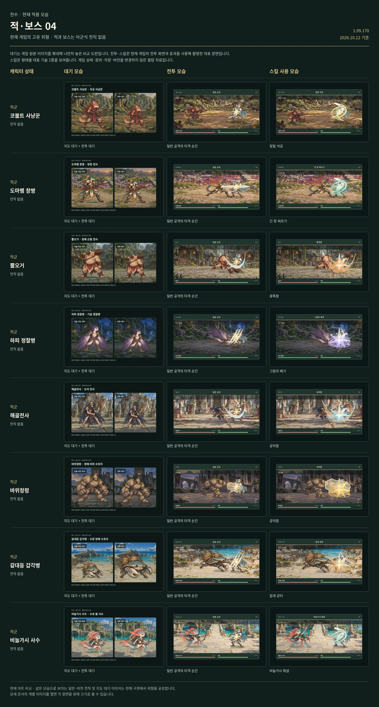

# 하피 정찰병

[← 적·보스 목록](README.md) · [전체 캐릭터 목록](../README.md)

**구분:** 일반 적 · **역할:** 기습 정찰병

**아래 비교표의 위에서 4번째 행이 하피 정찰병입니다.** 왼쪽부터 대기 / 전투 / 대표 스킬 순서입니다.

대표 스킬: **그림자 베기**

게임 데이터의 대표 기술명

[모음 04 비교표 크게 열기](../sheets/enemies-04.webp)

## 같은 비교표에 있는 외형

1. 코볼트 사냥꾼
2. 도마뱀 창병
3. 뿔오거
4. **하피 정찰병**
5. 해골전사
6. 바위정령
7. 갈대등 갑각병
8. 비늘가시 사수

적·보스에는 아군식 전직이 없습니다. 대기는 전술지도·전투 대기 아트 비교이며 전투·스킬은 현재 게임의 대표 장면입니다.
