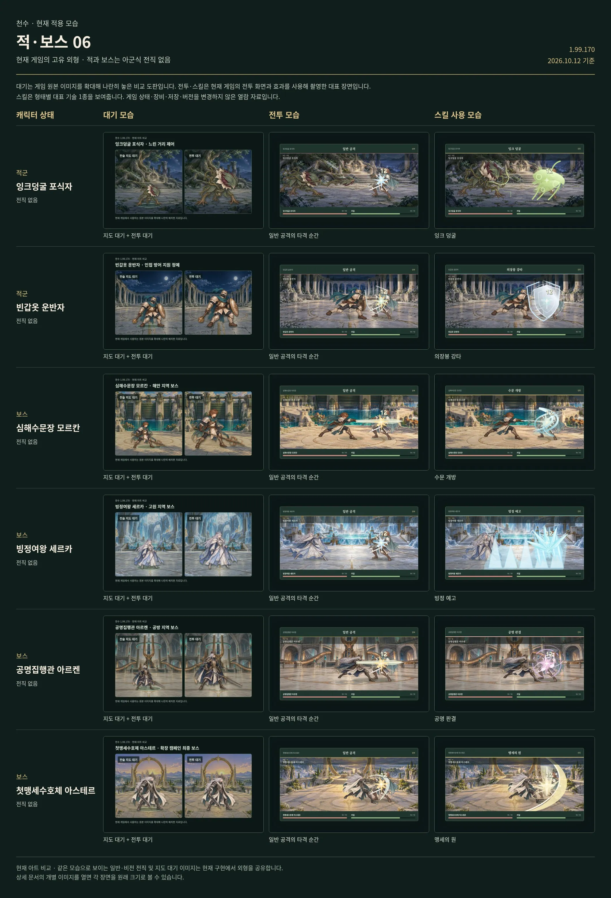

# 첫맹세수호체 아스테르

[← 적·보스 목록](README.md) · [전체 캐릭터 목록](../README.md)

**구분:** 보스 전용 외형 · **역할:** 확장 캠페인 최종 보스

**아래 비교표의 위에서 6번째 행이 첫맹세수호체 아스테르입니다.** 왼쪽부터 대기 / 전투 / 대표 스킬 순서입니다.

대표 스킬: **맹세의 원**

게임 데이터의 대표 기술명

[모음 06 비교표 크게 열기](../sheets/enemies-06.webp)

## 같은 비교표에 있는 외형

1. 잉크덩굴 포식자
2. 빈갑옷 운반자
3. 심해수문장 모르칸
4. 빙정여왕 세르카
5. 공명집행관 아르켄
6. **첫맹세수호체 아스테르**

적·보스에는 아군식 전직이 없습니다. 대기는 전술지도·전투 대기 아트 비교이며 전투·스킬은 현재 게임의 대표 장면입니다.

## 이 외형을 사용하는 스테이지 대장

| 스테이지 | 대장 이름 |
|---|---|
| 50장 · 함께 여는 새벽 | 첫 맹세 수호체 아스테르 |

보스의 2페이즈는 동일한 몸체 아트에 효과·표시·공격 패턴이 달라집니다.
