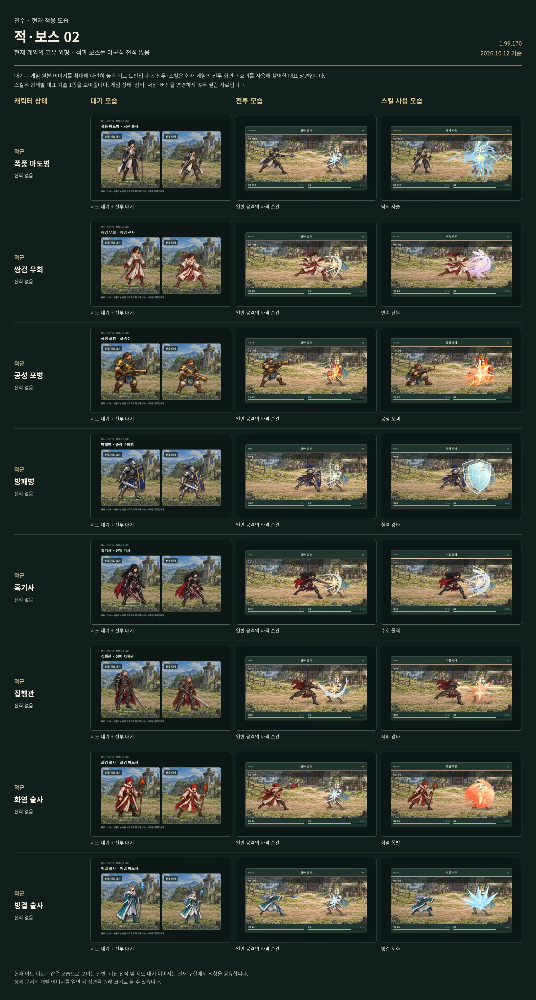

# 공성 포병

[← 적·보스 목록](README.md) · [전체 캐릭터 목록](../README.md)

**구분:** 일반 적 · **역할:** 포격수

**아래 비교표의 위에서 3번째 행이 공성 포병입니다.** 왼쪽부터 대기 / 전투 / 대표 스킬 순서입니다.

대표 스킬: **공성 포격**

게임 데이터의 대표 기술명

[모음 02 비교표 크게 열기](../sheets/enemies-02.webp)

## 같은 비교표에 있는 외형

1. 폭풍 마도병
2. 쌍검 무희
3. **공성 포병**
4. 방패병
5. 흑기사
6. 집행관
7. 화염 술사
8. 빙결 술사

적·보스에는 아군식 전직이 없습니다. 대기는 전술지도·전투 대기 아트 비교이며 전투·스킬은 현재 게임의 대표 장면입니다.
