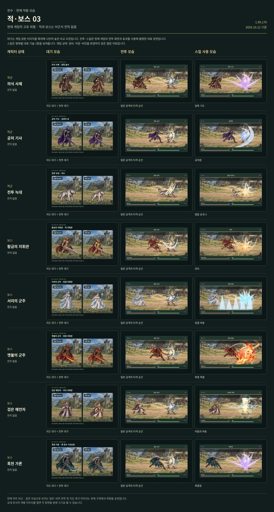

# 공허 기사

[← 적·보스 목록](README.md) · [전체 캐릭터 목록](../README.md)

**구분:** 일반 적 · **역할:** 심연의 검

**아래 비교표의 위에서 2번째 행이 공허 기사입니다.** 왼쪽부터 대기 / 전투 / 대표 스킬 순서입니다.

대표 스킬: **공허참**

게임 데이터의 대표 기술명

[모음 03 비교표 크게 열기](../sheets/enemies-03.webp)

## 같은 비교표에 있는 외형

1. 의식 사제
2. **공허 기사**
3. 전투 늑대
4. 황금의 지휘관
5. 서리의 군주
6. 잿불의 군주
7. 검은 예언자
8. 흑천 가론

적·보스에는 아군식 전직이 없습니다. 대기는 전술지도·전투 대기 아트 비교이며 전투·스킬은 현재 게임의 대표 장면입니다.
