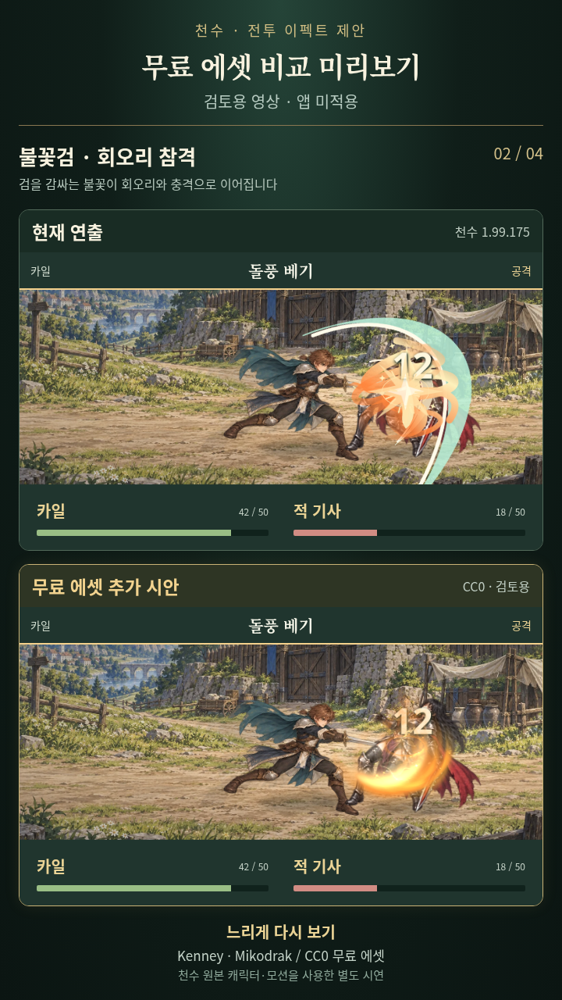
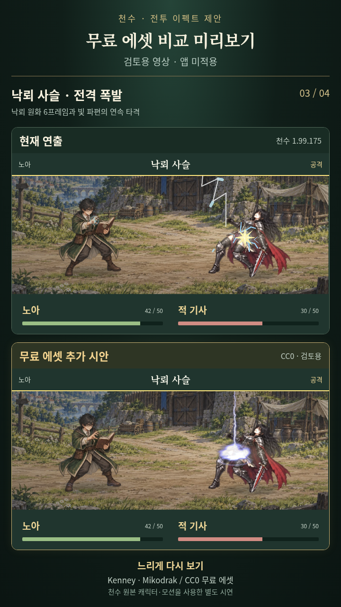
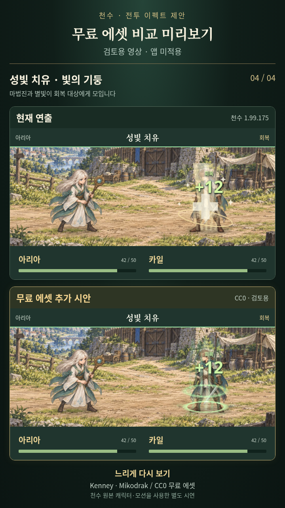

# 천수 무료 전투 이펙트 비교 시안

2026-10-14 KST. 사용자가 무료 에셋을 찾고 시스템 적용 전에 영상을 먼저 보여달라고 요청하여 제작한 **별도 미리보기**입니다. 이 브랜치는 영상과 조사 자료만 추가합니다. 게임 코드·인게임 에셋·버전·기존 저장·APK·OTA 채널은 변경하지 않았습니다.

[휴대폰용 MP4 영상 보기·다운로드](https://raw.githubusercontent.com/h0623-dev/cheonsu/codex/free-fx-preview-20261014/docs/previews/free-fx-20261014/cheonsu-free-fx-preview.mp4)

영상은 세로 720×1280, H.264 MP4, 무음입니다. 위쪽은 천수 1.99.175의 실제 CombatScene, 아래쪽은 같은 캐릭터·모션·시점에 무료 에셋을 조합한 후보입니다. 각 효과를 정상 속도와 느린 속도로 보여줍니다. 원본 캐릭터·배경·애니메이션을 재사용한 영상용 시연이며 실제 앱에 통합한 결과나 QA 통과 결과가 아닙니다.

1. 카일 일반 공격: 무료 검격·잔광·타격 파편.
2. 카일 돌풍 베기: 검의 불꽃 회오리·불꽃 검격·접촉 충격.
3. 노아 낙뢰 사슬: 무료 낙뢰 원화 6프레임·전격 파편.
4. 아리아 성빛 치유: 무료 마법진·별빛·회복 광선.

## 실제 사용한 외부 에셋

- [Kenney Particle Pack 공식 페이지](https://kenney.nl/assets/particle-pack): Kenney Vleugels. **CC0 1.0**, 무료이며 상업 이용·수정·재배포가 가능합니다. 출처 표기는 의무가 아니지만 이 영상과 자료에는 표시합니다. 512px PNG 중 32종을 영상용으로 색조·크기·회전·재생 타이밍을 조절했습니다. [공개 재포장본](https://github.com/Calinou/kenney-particle-pack)의 commit `ab7086639ee73be31abd87feb21bf1402d4e8144`에서 실제 수집했으며 동봉 LICENSE.txt를 보존했습니다.
- [Mikodrak 2D Spell Effects 원작 페이지](https://opengameart.org/content/2d-spell-effects): Mikodrak (Martin Jelinek). **CC0**, 상업 이용·수정·재배포 가능. [Flare의 해당 파일별 원작·CC0 크레딧](https://github.com/flareteam/flare-game/wiki/Credits)을 확인한 `thunderstrike.png`만 사용했습니다. 공개 Flare commit `af6eee6d339ac98011864bfe89da837fe7769c28`의 시트·6개 프레임과 앵커를 사용했습니다. Flare의 다른 코드나 게임 에셋을 CC0라고 가정하지 않았습니다.

[MetaShinryu Slash Effect Collection](https://opengameart.org/content/slash-effect-collection)도 CC0 후보로 조사했지만 원본 ZIP 다운로드가 실행 환경 정책에 막혀 영상에는 사용하지 않았습니다. Kenney와 Mikodrak은 접근이 허용된 GitHub 공개 배포본을 정상 다운로드했습니다. 정책·프록시·TLS를 우회하지 않았습니다.

공식 페이지 확인은 2026-10-14에 수행했습니다. 상업 이용 조건은 원작자가 표시한 라이선스 기준이며 전체 천수의 출시 법률 검토나 다른 에셋의 저작권 보증을 뜻하지 않습니다. 실제 수집 경로·원작 라이선스·파일 SHA-256·낙뢰 프레임 좌표는 asset-research.json에 보존합니다.

## 대표 장면

앱 적용 여부는 이 시안을 확인한 뒤 별도 요청으로 결정합니다. 게임은 변경하지 않았고 테스트·린트·QA·APK 검증·배포도 실행하지 않았습니다. 미리보기 촬영·MP4 제작만 수행했습니다.

2026-10-14 KST 사용자가 **“공개 미리보기 업로드 허용”**을 명시하여 이 별도 브랜치에 영상·출처 자료만 공개했습니다. 게임 적용 승인을 뜻하지 않으며 `main`·게임 버전·APK·OTA 채널은 유지합니다.
