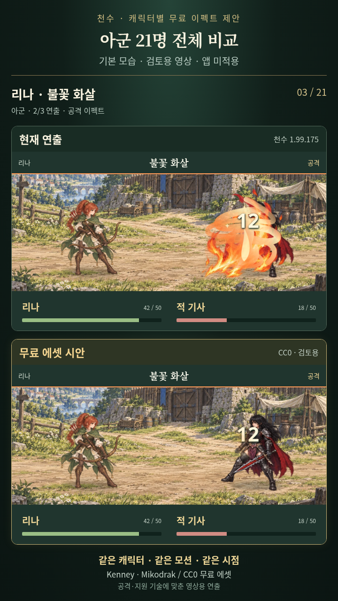
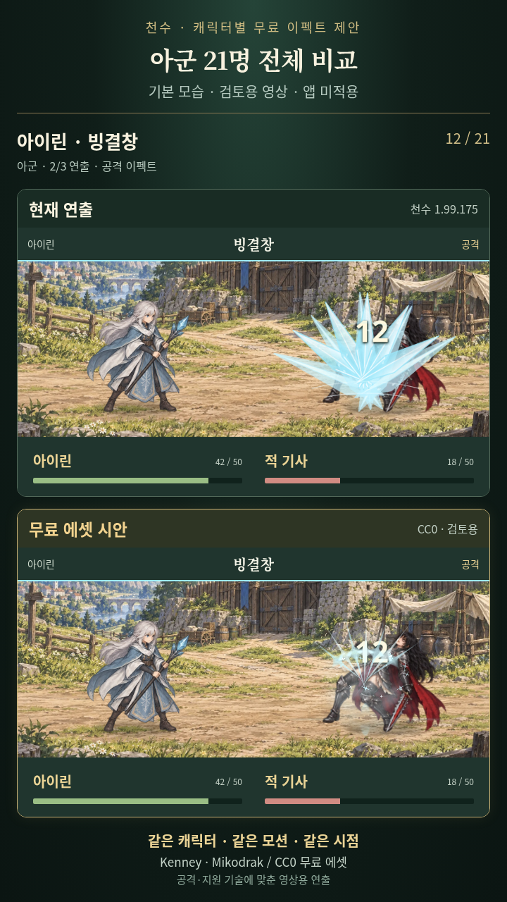
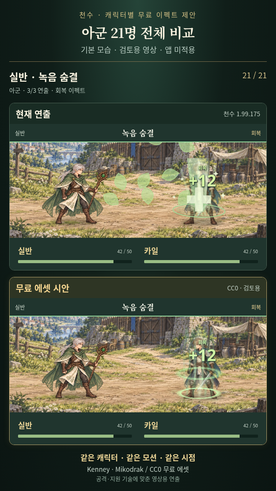

# 아군 21명 무료 전투 이펙트 전체 비교

사용자가 “아군 21명 전체”로 범위를 확정한 요청에 따라 제작한 별도 미리보기입니다. **아군 21명·기본 공격 21개·고유 기술 42개, 총 63장면**을 7명씩 3편으로 나눴습니다. 기본 외형으로 각자의 공격·두 기본 기술을 보여주며, 전직 외형·비전 기술까지 모두 시연한 영상은 아닙니다.

위쪽은 천수 1.99.175의 현재 연출, 아래쪽은 실제 CC0 무료 에셋으로 구성한 시안입니다. 같은 캐릭터·모션·공격 시점에서 비교합니다. 수치는 영상용 예시이며 실제 스테이지 승패·피해 검증 영상이 아닙니다. 앱 코드·인게임 에셋·버전·저장·main·APK·OTA 채널은 변경하지 않았습니다.

## 휴대폰용 영상

- [1편 MP4 다운로드](https://raw.githubusercontent.com/h0623-dev/cheonsu/codex/free-fx-preview-20261014/docs/previews/free-fx-20261014/all-allies/cheonsu-all-allies-01.mp4) — 카일·브람·리나·아리아·레온·세라·노아 / 약 59초 / 18.8 MB
- [2편 MP4 다운로드](https://raw.githubusercontent.com/h0623-dev/cheonsu/codex/free-fx-preview-20261014/docs/previews/free-fx-20261014/all-allies/cheonsu-all-allies-02.mp4) — 유나·라칸·미호·테오·아이린·카즈·엘라 / 약 59초 / 18.4 MB
- [3편 MP4 다운로드](https://raw.githubusercontent.com/h0623-dev/cheonsu/codex/free-fx-preview-20261014/docs/previews/free-fx-20261014/all-allies/cheonsu-all-allies-03.mp4) — 진·루카·백호·마레·하린·에단·실반 / 약 59초 / 19.8 MB

세로 720×1280, H.264 MP4, 30fps, 무음입니다. 직접 링크를 열면 파일이 다운로드될 수 있으며 휴대폰 파일 앱·영상 플레이어에서 열 수 있습니다. 실제 휴대폰 플레이 결과를 주장하는 자료가 아닙니다.

## 캐릭터별 영상 위치와 기술

| 영상 | 시작 위치 | 캐릭터 | 기본 무기 | 기술 1 | 기술 2 |
| --- | --- | --- | --- | --- | --- |
| 1편 | 약 00:00 | 카일 | 검 | 돌풍 베기 | 수호의 맹세 |
| 1편 | 약 00:08 | 브람 | 방패 | 철벽 수호 | 방패 강타 |
| 1편 | 약 00:16 | 리나 | 활 | 불꽃 화살 | 정밀 사격 |
| 1편 | 약 00:25 | 아리아 | 성빛 마법 | 성빛 치유 | 성역의 기도 |
| 1편 | 약 00:33 | 레온 | 창 | 관통 찌르기 | 질풍 돌격 |
| 1편 | 약 00:41 | 세라 | 단검 | 암영 베기 | 빈틈 가르기 |
| 1편 | 약 00:50 | 노아 | 번개 마법 | 낙뢰 사슬 | 전술 방벽 |
| 2편 | 약 00:00 | 유나 | 성빛 마법 | 달빛 회복 | 정화의 기도 |
| 2편 | 약 00:08 | 라칸 | 중량 무기 | 대지 분쇄 | 불굴의 포효 |
| 2편 | 약 00:16 | 미호 | 불꽃 마법 | 여우불 | 환영 폭발 |
| 2편 | 약 00:24 | 테오 | 활 | 삼연사 | 관통 화살 |
| 2편 | 약 00:33 | 아이린 | 얼음 마법 | 빙결창 | 서리 파동 |
| 2편 | 약 00:41 | 카즈 | 단검 | 그림자 습격 | 급소 찌르기 |
| 2편 | 약 00:49 | 엘라 | 악기 | 치유의 선율 | 공명 파동 |
| 3편 | 약 00:00 | 진 | 검 | 용염참 | 월광참 |
| 3편 | 약 00:08 | 루카 | 검 | 기사 돌격 | 수호의 빛 |
| 3편 | 약 00:17 | 백호 | 권법 | 백호권 | 백호 포효 |
| 3편 | 약 00:25 | 마레 | 창 | 해류 찌르기 | 물길 엄호 |
| 3편 | 약 00:33 | 하린 | 권법 | 온맥수 | 연환권 |
| 3편 | 약 00:42 | 에단 | 중량 무기 | 파쇄 망치 | 접이식 방벽 전개 |
| 3편 | 약 00:50 | 실반 | 자연 룬술 | 뿌리 얽기 | 녹음 숨결 |

검격·불꽃 검격·활·창·중병기·권격·마법탄·번개·얼음·암영·음파·자연·회복·수호의 14종 영상용 조합을 사용합니다. 불꽃은 카일·진의 검, 리나의 화살, 미호의 마법탄에 맞춰 다르게 구성했습니다. 방벽은 아군 보호, 회복은 대상 중심의 빛, 냉기·자연은 해당 속성의 입자와 원화로 표현합니다.

## 무료 에셋 출처

- [Kenney Particle Pack](https://kenney.nl/assets/particle-pack): Kenney Vleugels, CC0 1.0. 실제 공개 PNG의 색조·회전·크기·타이밍을 조정하여 사용했습니다.
- [Mikodrak 2D Spell Effects](https://opengameart.org/content/2d-spell-effects): CC0. [Flare 파일별 크레딧](https://github.com/flareteam/flare-game/wiki/Credits)의 thunderstrike.png 원작·라이선스를 확인하여 낙뢰 6프레임을 사용했습니다.

동봉 원작 라이선스와 실제 수집 경로·파일 해시·원작 URL은 [앞선 조사 자료](../README.md)에 보존합니다. 인게임 캐릭터·모션·배경은 현재 천수 공개 소스를 읽기 전용으로 재사용했습니다.

## 대표 장면

사용자의 기존 **“공개 미리보기 업로드 허용”** 승인에 따라 같은 공개 저장소의 같은 미리보기 브랜치로 전달합니다. 이 승인은 앱 적용 승인이 아니며, 실제 적용은 이후 별도 요청에 따릅니다. 게임 변경·테스트·린트·QA·APK/OTA 제작·배포는 실행하지 않았습니다. 미리보기 촬영과 MP4 제작만 수행했습니다.
